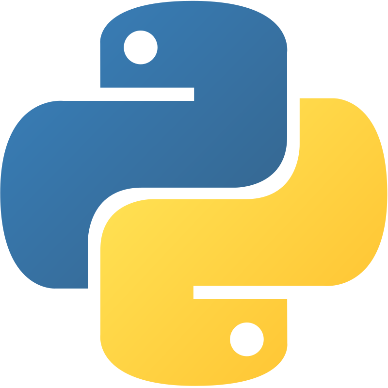
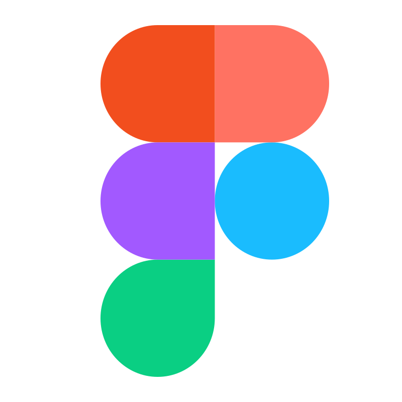
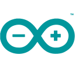

<div align="center">


<a href="https://github.com/Praneeth-ram">
  
</a>

<br><br>

<p>
  <a href="https://praneethram08.netlify.app/"></a>
  <a href="https://www.linkedin.com/in/praneeth-ram-72487527b/"></a>
  <a href="https://github.com/Praneeth-ram"></a>
  
</p>

</div>

---

## 👾 Hi, I'm Praneeth Ram

I build AI-powered applications and scalable software solutions, blending backend engineering, modern web technologies, and Generative AI. I focus on clean architecture, reliable APIs, and intelligent systems that turn complex data into practical tools people can use every day.


## ⚡ About Me

- 🎓 Computer Science and Engineering graduate.
- 💻 Interested in Software Engineering, AI/ML, and Generative AI.
- 🤖 Building LLM-powered applications using RAG, semantic search, and agent-based workflows.
- ⚙️ Experienced in developing backend services and REST APIs using Python and FastAPI.
- 🌐 Building full-stack applications with React, PostgreSQL, and modern development tools.
- 📚 Continuously exploring system design, AI engineering, and scalable application development.

---

## 🖥️ System Profile

```bash
praneeth@matrix:~$ whoami
> Software Engineer | AI/ML Developer | Full-Stack Developer

praneeth@matrix:~$ cat focus.txt
> Backend  : Python, FastAPI, REST APIs
> Frontend : React, HTML, CSS
> AI/ML    : LLMs, RAG, Semantic Search, Agents
> Data     : PostgreSQL, Redis
> DevOps   : Docker, Git, GitHub Actions, Linux

praneeth@matrix:~$ _
```

---

## 🧬 Tech Stack

<div align="center">

### 💻 Languages

&nbsp;&nbsp;&nbsp;
&nbsp;&nbsp;&nbsp;
&nbsp;&nbsp;&nbsp;
&nbsp;&nbsp;&nbsp;


### 🎨 Frontend

&nbsp;&nbsp;&nbsp;
&nbsp;&nbsp;&nbsp;


### ⚙️ Backend

&nbsp;&nbsp;&nbsp;
&nbsp;&nbsp;&nbsp;
&nbsp;&nbsp;&nbsp;

### 🗄️ Databases

&nbsp;&nbsp;&nbsp;


### 🧠 AI & Machine Learning

&nbsp;&nbsp;&nbsp;
&nbsp;&nbsp;&nbsp;
&nbsp;&nbsp;&nbsp;
&nbsp;&nbsp;&nbsp;
&nbsp;&nbsp;&nbsp;
&nbsp;&nbsp;&nbsp;
&nbsp;&nbsp;&nbsp;

&nbsp;&nbsp;&nbsp;
&nbsp;&nbsp;&nbsp;

### 🛠️ Tools

&nbsp;&nbsp;&nbsp;
&nbsp;&nbsp;&nbsp;
&nbsp;&nbsp;&nbsp;
&nbsp;&nbsp;&nbsp;
&nbsp;&nbsp;&nbsp;
&nbsp;&nbsp;&nbsp;
&nbsp;&nbsp;&nbsp;
&nbsp;&nbsp;&nbsp;
&nbsp;&nbsp;&nbsp;
&nbsp;&nbsp;&nbsp;


</div>

---
## 💡 Featured Projects

### 📄 Smart Resume Analyzer

An AI-powered recruitment application that analyzes resumes, evaluates job relevance, and identifies skill gaps to support candidate screening.

- Developed REST APIs using FastAPI and built the frontend with React.
- Implemented resume parsing and information extraction using PyMuPDF.
- Integrated ATS-based screening and job-description matching.
- Used LLM-powered analysis to generate candidate insights and skill-gap recommendations.
- Integrated PostgreSQL for application data management.

**Stack:** Python · FastAPI · React · PostgreSQL · Ollama · LLMs · PyMuPDF

[](https://github.com/Praneeth-ram/smart-resume-analyzer)

---

### 🎯 YOLOv8 Multi-Person Tracking

A computer vision application for detecting and tracking multiple people across video frames with persistent tracking IDs.

- Implemented person detection using YOLOv8.
- Integrated ByteTrack for multi-object tracking.
- Used OpenCV for video processing and annotated output generation.
- Explored Kalman Filtering, IoU association, and Hungarian Matching for object tracking.
- Evaluated tracking performance using MOT metrics such as MOTA and IDF1.

**Stack:** Python · YOLOv8 · ByteTrack · OpenCV · Docker · FFmpeg

[](https://github.com/Praneeth-ram/YOLOv8-Person-Tracking)

## 📊 GitHub Statistics

<div align="center">


</div>

---

---

## 🤝 Connect With Me

<div align="center">

I'm open to Software Engineering, AI Engineering, and Full-Stack Development opportunities.

<br>

<a href="https://www.linkedin.com/in/praneeth-ram-72487527b/"></a>&nbsp;&nbsp;
<a href="https://praneethram08.netlify.app/"></a>&nbsp;&nbsp;
<a href="https://github.com/Praneeth-ram"></a>

<br><br>


<i>Building, learning, and turning ideas into practical software solutions.</i>

</div>
